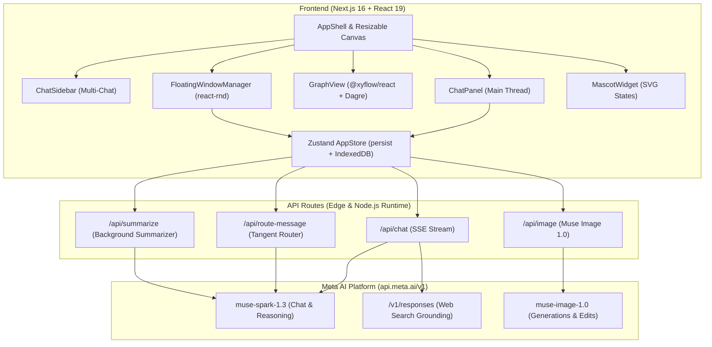

# 🌸 Sakura Chat (桜チャット)

> **Branching AI Conversations with Visual Thought Trees & Mascot Companions**  
> *Built for the Meta Global AI Developer Hackathon 2026*  
> Powered by **Meta Muse Spark 1.3**, **Meta Muse Image 1.0**, and **Meta Responses API (Search Grounding)**.

---

## 🌟 Overview & Problem Statement

Traditional conversational AI interfaces are strictly linear: every question, tangent, deep-dive, and rabbit hole is stacked sequentially into a single endless thread. As soon as you ask a follow-up question or explore an alternative idea, the original context is polluted or lost forever.

**Sakura Chat** reimagines human-AI dialogue as a living, branching thought tree:
- **Never lose context**: Main threads remain pure while exploratory tangents branch off cleanly.
- **Visual reasoning canvas**: See your conversation structure at a glance via an interactive node graph powered by React Flow and Dagre.
- **Intelligent tangent routing**: Meta Muse Spark 1.3 monitors replies in real-time, automatically routing tangents into floating side windows.
- **ChatGPT-style multi-chat sidebar**: Manage multiple distinct conversations, each with its own independent graph tree.
- **Elastic resizable split-view**: Adjust your workspace with a draggable partition between the graph and chat panels.
- **Live web search grounding**: Query current web facts with source citations directly via the Meta Responses API.
- **Multi-modal creation**: Generate and edit images with Meta Muse Image 1.0, import/export documents (PDF/DOCX/Markdown), and inspect the exact token payloads sent to the model.
- **Kawaii mascot companions**: Three animated companions—**Mochi**, **Boba**, and **Pip**—react dynamically to every stage of reasoning and search.

```
┌─────────────────┐ ┌────────────────────────────────────────┐ ┌───┐ ┌───────────────────────────┐
│  📁 SIDEBAR     │ │             🌳 GRAPH VIEW              │ │ ⟺ │ │        💬 CHAT PANEL      │
│  (Multi-Chat)   │ │  (Interactive React Flow Node Tree)    │ │   │ │  (Main Thread Dialogue)   │
│                 │ │                                        │ │ D │ │                           │
│ + New Chat      │ │  [Turn 1] ───► [Turn 2] ───► [Turn 3]   │ │ I │ │ User: Hi Mochi!           │
│                 │ │                   │                    │ │ V │ │ Assistant: Konnichiwa! 🌸 │
│ • Kyoto Neko    │ │                   ▼ (Side branch)      │ │ I │ │                           │
│ • SciFi Novel   │ │            [Floating Window]           │ │ D │ │ [Input Box] [🖼️] [📄] [🌐]│
│ • Research      │ │                                        │ │ E │ │                           │
│                 │ │  MiniMap, zoom/pan controls, auto-fit │ │ R │ │ Breadcrumbs, Context Insp │
└─────────────────┘ └────────────────────────────────────────┘ └───┘ └───────────────────────────┘
```

---

## ✨ Key Features

### 1. 🌳 Branching Conversation Trees & Visual Graph
- **Interactive Tree View**: Explore conversation flow through a DAG layout rendered with `@xyflow/react` and `@dagrejs/dagre`.
- **Node Cards**: Displays preview text, mascot status, citations, attached images, documents, and pinned notes.
- **Non-Linear Navigation**: Click any node in the graph or breadcrumb trail to inspect and branch alternative futures without deleting prior history.
- **Multiple Versions**: Edit earlier user prompts to branch into versioned alternatives (`1 of 3`), toggling between paths instantly.

### 2. 🗂️ Multi-Chat System (ChatGPT-Style)
- **Independent Graphs**: Each conversation maintains its own isolated graph structure, message history, and floating windows.
- **Collapsible Sidebar**: Desktop collapsible drawer (expandable to full list or compact icon rail) and mobile slide-out overlay.
- **Conversation Management**: Create new chats, inline rename (double-click or edit icon), and delete chats with an instant **Undo** toast.
- **Zero-Friction Auto-Titling**: The first turn automatically names the conversation without extra latency.

### 3. ⟺ Resizable Canvas Partition
- **Fluid Drag Divider**: Grab and move the boundary between the graph canvas and chat panel with smooth pointer capture.
- **Smart Constraints**: Enforces minimum bounds (250px graph, 280px chat) so neither view collapses unexpectedly.
- **Touch & Keyboard Support**: Works on mobile touch devices and supports `ArrowLeft` / `ArrowRight` keyboard adjustments.
- **Double-Click Reset**: Double-click the divider to immediately restore the balanced default width.

### 4. 🪟 Auto-Branching & Floating Tangent Windows
- **Auto-Tangent Detection**: When `Auto-branch` is enabled, Meta Muse Spark analyzes user replies in parallel. When a user asks an aside or tangent, it automatically lifts that message into a floating side window so the main thread remains coherent.
- **Multi-Window Manager**: Manage up to 3 simultaneous floating side-branch windows with drag, resize, minimize, and z-index ordering.
- **Summary Pinning**: Pinned insights from closed side branches roll up directly back into the main tree's context window.

### 5. 🌐 Live Web Search Grounding (Meta Responses API)
- **Live Web Access**: pip can toggle web search to fetch real-time information through Meta's `https://api.meta.ai/v1/responses` API with `tools: [{ type: "web_search" }]`.
- **Query Transparency & Citations**: Displays PIP's exact search queries and embeds clickable numbered source citations in replies.

### 6. 🎨 Multi-Modal Suite (Muse Image 1.0 & Documents)
- **Image Generation**: Generate high-fidelity images with Meta Muse Image 1.0 (`1024x1024`, `1536x1024`, `1024x1536`).
- **Multi-Turn Image Editing**: Feed previously generated images back as reference inputs for stylistic iterations.
- **Document Ingestion**: Upload PDFs, DOCX, and plain text files with automatic text extraction and token-aware context planning.
- **Document Creation Mode**: Dedicated prompt mode for generating structured markdown, exportable to DOCX and PDF.

### 7. 🍡 Kawaii Mascot Companion System
Three expressive companions accompany the user, reflecting real-time AI states:
| Mascot | Persona | Role & Ability |
|---|---|---|
| **Mochi** 🍡 | *Chief Sweetheart & Guide* | Main thread guide, cozy explanations, and optimistic synthesis (`#FFB7D5`) |
| **Boba** 🧋 | *Branch & Tangent Navigator* | Watches for tangents, orchestrates side windows, and summarizes side threads (`#D4C1F5`) |
| **Pip** 🌸 | *Context Sniffer & Scout* | Live web grounding scout, file inspector, and token auditor (`#C6F1DC`) |

*Mascot states transition dynamically:* `idle` ➔ `thinking` ➔ `writing` ➔ `sniffing` (web search) ➔ `branching` ➔ `success` ➔ `error`.

### 8. 🔍 Context Inspector & Token Auditor
- Inspect the exact context payload being packaged for Meta Muse Spark.
- View system prompt reserves, conversation ancestor history, side-branch pins, and file tokens with clear visual breakdowns.

### 9. 🔒 Local-First Privacy & Zero Lock-in
- **No external DB required**: All chat states, branches, and metadata persist in browser `localStorage`.
- **IndexedDB Blob Store**: Uploaded documents and generated images are saved locally via IndexedDB.
- **Full Bundle Export & Import**: Export conversations into a single portable `.json` file containing full tree graphs, metadata, and base64-embedded images.

---

## 🛠️ Architecture & Tech Stack



### Core Technologies
- **Framework**: [Next.js 16.4.5](https://nextjs.org/) with React 19 and Turbopack
- **Language**: TypeScript 5 (Strict Mode)
- **Styling**: Tailwind CSS v4 with custom Kawaii Sticker design tokens
- **State Management**: Zustand 5 with custom `safeStorage` adapter and schema migration
- **Graph Visualization**: `@xyflow/react` (React Flow 12) + `@dagrejs/dagre`
- **Floating Windows**: `react-rnd` (drag, resize, bounds constraints)
- **Document Processing**: `pdfjs-dist`, `mammoth` (DOCX), `docx` (generation), `pdfmake`
- **Streaming Parser**: `eventsource-parser` v4

---

## 🤖 Meta AI API Integration Details

Sakura Chat deeply integrates with Meta AI endpoints:

### 1. Chat Completions (`muse-spark-1.3`)
- **Endpoint**: `POST https://api.meta.ai/v1/chat/completions`
- **Configuration**:
  - `stream: true` for responsive real-time generation
  - `reasoning_effort: "minimal"` to achieve fast initial token delivery (~1.7s time-to-first-token)
  - `max_tokens: 6000` to allow room for reasoning tokens without truncation

### 2. Live Web Search Grounding (`Meta Responses API`)
- **Endpoint**: `POST https://api.meta.ai/v1/responses`
- **Payload**:
  ```json
  {
    "model": "muse-spark-1.3",
    "input": [
      { "role": "system", "content": "..." },
      { "role": "user", "content": "What are latest developments in robotics?" }
    ],
    "tools": [{ "type": "web_search" }],
    "stream": true
  }
  ```
- **Stream Processing**: Handled via server-sent events parsing tool calls (`web_search`), collecting search queries, and streaming response markdown with embedded citations.

### 3. Image Generation & Iteration (`muse-image-1.0`)
- **Endpoint**: `POST https://api.meta.ai/v1/images/generations` and `POST https://api.meta.ai/v1/images/edits`
- **Sizes Supported**: `1024x1024` (Square), `1536x1024` (Landscape), `1024x1536` (Portrait)
- Reference image inputs enable multi-turn artistic refinement.

### 4. Semantic Tangent Routing & Summarization
- Parallel lightweight calls to `muse-spark-1.3` classify whether a user input belongs in the main thread, represents a side tangent (`tangent`), or warrants a completely fresh topic tree (`new_topic`).

---

## 🚀 Getting Started

### Prerequisites
- **Node.js**: v20 or higher (v24 recommended)
- **npm** or **pnpm**
- **Meta AI API Key** with access to `muse-spark-1.3` and `muse-image-1.0`

### 1. Clone & Install
```bash
git clone https://github.com/your-username/sakura-chat.git
cd sakura-chat
npm install
```

### 2. Configure Environment Variables
Create a `.env.local` file in the project root:
```env
# Your Meta AI API Key
META_API_KEY=your_meta_api_key_here

# Optional: Default model override (defaults to muse-spark-1.3)
# META_MODEL_CHAT=muse-spark-1.3
```

### 3. Start the Development Server
```bash
npm run dev
```

Open [http://localhost:3000](http://localhost:3000) in your browser.

### 4. Build for Production
```bash
npm run build
npm run start
```

---

## 🍵 Interactive Demo Walkthrough

Want to experience Sakura Chat immediately without entering prompts?

1. Click the **✨ Demo Mode** button in the top navigation bar (or navigate to `http://localhost:3000?demo=1`).
2. This loads the **Kyoto Cat Sanctuary ("Neko no Niwa")** demo conversation:
   - **Main Thread**: Concept design ➔ Acoustic zoning ➔ Signature kissaten menu ➔ Grand opening roadmap.
   - **Side Branches**: Cat welfare policies, kitten adoption flow, and cat dining safety protocols.
3. Test clicking any node on the left graph to instantly inspect it in the chat panel.
4. Open the floating side window by clicking a purple dashed node.
5. Drag the divider to resize the graph and chat split.
6. Click **+ New Chat** in the sidebar to start your own tree while keeping the demo accessible!

---

## 🎨 Design Philosophy & Kawaii Sticker Aesthetic

Sakura Chat marries developer-grade productivity with an approachable, playful Japanese kissaten aesthetic:

- **Border Ink & Tactile Shadows**: Chunky `border-2 border-[var(--ink)]` with crisp offset drop-shadows (`box-shadow: 0 2px 0 var(--ink)`).
- **Pastel Palette**:
  - 🌸 Sakura Pink: `#FFB7D5` (Primary accents, Mochi)
  - 🧋 Boba Lavender: `#D4C1F5` (Side branches, Boba)
  - 🍵 Mint Cream: `#C6F1DC` (Context inspector, Pip)
  - 🧈 Warm Butter: `#FDE89C` (Demo highlights, badges)
  - 🍦 Soft Cream: `#FFF7F2` (Background workspace)
  - 🖋️ Sumi Ink: `#2A2438` (High contrast typography)
- **Micro-Animations**: Expressive SVG mascot eyes and ear twitches matching real-time generation states.

---

## 📂 Project Structure

```
sakura-chat/
├── src/
│   ├── app/
│   │   ├── api/
│   │   │   ├── chat/route.ts          # Meta Muse Spark & Responses streaming
│   │   │   ├── image/route.ts         # Meta Muse Image 1.0 generation
│   │   │   ├── route-message/route.ts # Tangent classifier
│   │   │   ├── summarize/route.ts     # Turn background summarizer
│   │   │   └── test-meta/route.ts     # Healthcheck & credentials diagnostics
│   │   ├── globals.css                # Kawaii sticker utility classes & theme tokens
│   │   ├── layout.tsx                 # Root layout with custom font loaders
│   │   └── page.tsx                   # Main entry point mounting AppShell
│   ├── components/
│   │   ├── AppShell.tsx               # Main layout coordinator & header controls
│   │   ├── ChatSidebar.tsx            # Multi-chat list, new chat, rename, delete
│   │   ├── ResizableDivider.tsx       # Draggable partition with min/max constraints
│   │   ├── GraphView.tsx              # React Flow canvas & auto-fit layout
│   │   ├── TurnNodeCard.tsx           # Custom React Flow node card
│   │   ├── ChatPanel.tsx              # Main dialogue stream & message turns
│   │   ├── ChatInput.tsx              # Multi-modal input bar (web/img/doc toggles)
│   │   ├── MessageTurn.tsx            # Message bubble, markdown, version switcher
│   │   ├── FloatingWindow.tsx         # Drag & resizable side-branch window
│   │   ├── FloatingWindowManager.tsx  # Multi-window z-index stack
│   │   ├── MascotWidget.tsx           # Vector SVG animated mascot companions
│   │   ├── ContextInspector.tsx       # Token budget & prompt preview modal
│   │   ├── Breadcrumbs.tsx            # Path trail with click-to-scroll
│   │   └── Toast.tsx                  # Actionable notifications with Undo
│   └── lib/
│       ├── types.ts                   # Core TypeScript domain models
│       ├── store.ts                   # Zustand app store with safeStorage persist
│       ├── conversations.ts           # Multi-chat helpers & root migration
│       ├── chat-actions.ts            # Message dispatch, retry, abort, undo
│       ├── graph-layout.ts            # Dagre hierarchical layout calculation
│       ├── tree-utils.ts              # Tree path calculation, versions, roots
│       ├── file-store.ts              # IndexedDB blob storage for uploads/images
│       ├── bundle.ts                  # Export/import JSON with embedded media
│       └── stream.ts                  # SSE parsing & abort controller
├── public/                            # Static assets and icons
├── package.json
├── tsconfig.json
└── README.md
```

---

## 🏆 Meta AI Hackathon 2026 Submission

- **Track**: Agentic & Conversational AI Workflows / Next-Gen AI Interfaces
- **Models**:
  - `muse-spark-1.3` (Chat, reasoning, tangent routing, summarization)
  - `muse-image-1.0` (Image generation and iterative editing)
  - `Meta Responses API` (Live web search grounding with source citations)
- **Key Value Proposition**: Solving context decay and tangent clutter in complex problem-solving dialogues through visual tree branching and automated tangent management.

---

## 📄 License

This project is licensed under the MIT License. Feel free to use, modify, and build upon it!

---

<p align="center">
  Made with 🌸, 🍡, and Meta AI Muse Spark for the Meta Global AI Developer Hackathon 2026.
</p>
